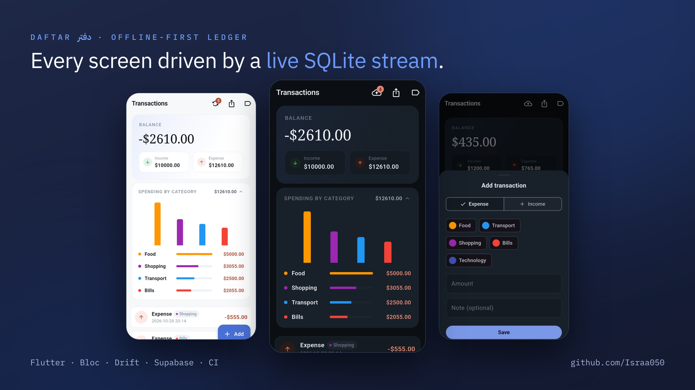
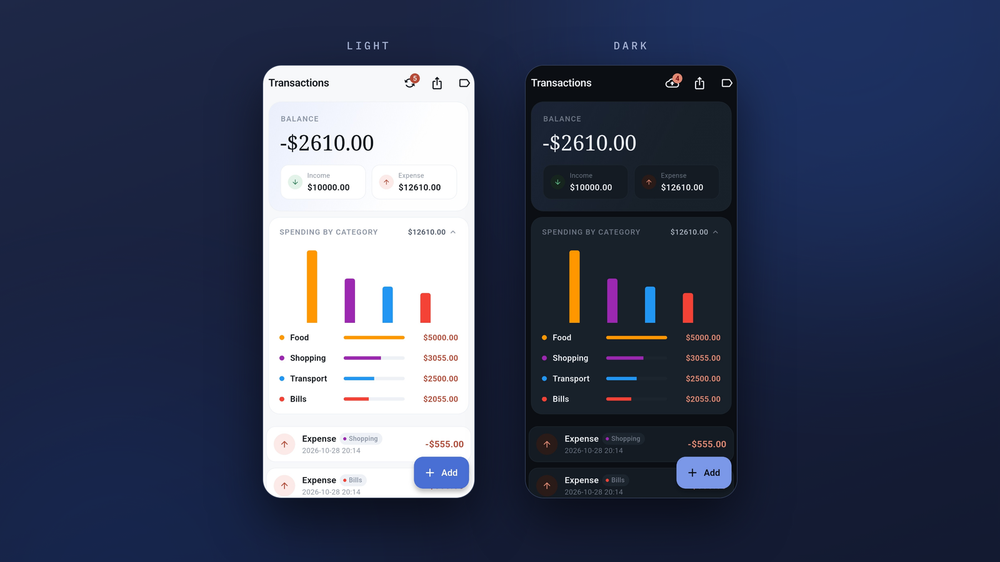
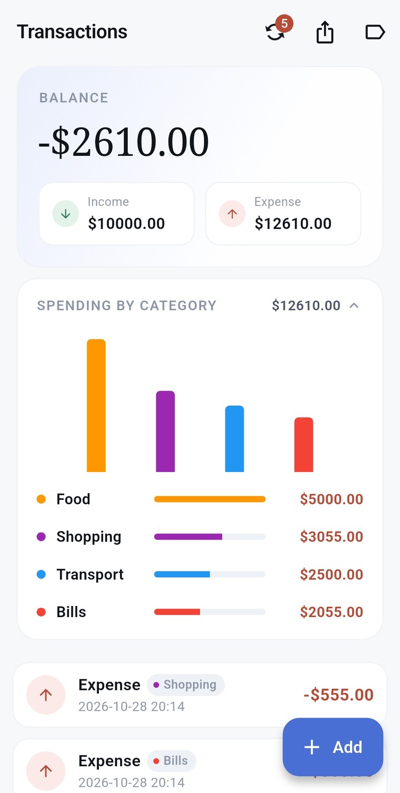
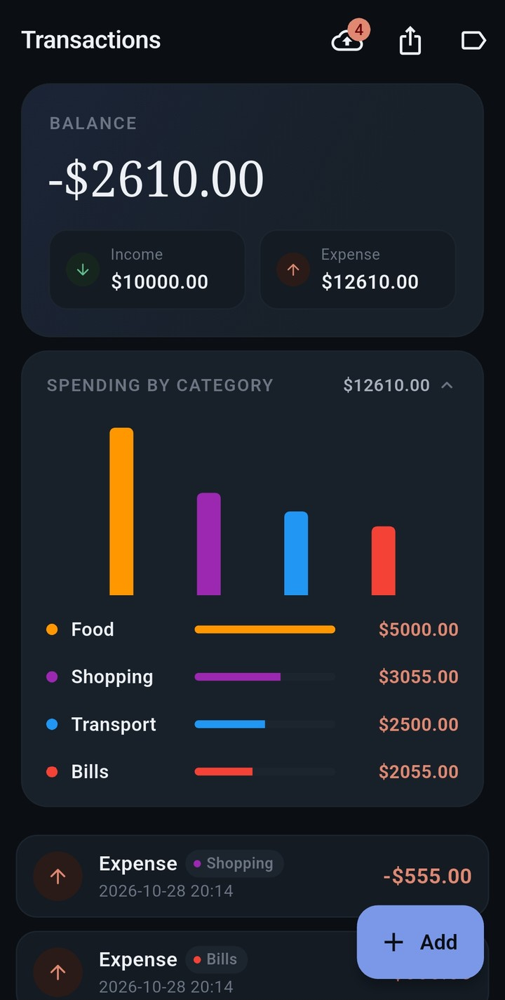

# Daftar

> Formerly "Money Log".

<p align="center">
  
</p>

<details>
<summary>More screenshots</summary>

<p align="center">
  
</p>

<p align="center">
  
  &nbsp;&nbsp;
  
</p>

<p align="center">
  <em>Balance, income/expense pills, and a live spending chart above the category rows &nbsp;·&nbsp; the sync badge shows how many changes are waiting</em>
</p>

</details>

<p align="center">
  
  
  
  
  
  <a href="LICENSE"></a>
</p>

<p align="center">
  <a href="https://github.com/Israa050/Daftar/releases/latest">
    
  </a>
</p>

<p align="center">
  <a href="https://claude.ai/code/artifact/7ef70167-84d3-4ec5-b1da-6acea789d354">📊 Interactive architecture diagram</a>
  &nbsp;·&nbsp;
  <a href="https://claude.ai/code/artifact/97b41c14-86fe-47d7-bbc0-a13aed14b7d2">🖱️ Live interactive demo</a>
  &nbsp;·&nbsp;
  <a href="https://drive.google.com/file/d/1nQkCstSZAbhRjJtGAFgpa33XMK7P3h3f/view?usp=sharing">🎬 App demo video</a>
</p>

<p align="center">
  
</p>

---

## 📖 About

**Daftar** is a small, focused personal-finance tracker: log income and
expenses, see your balance update instantly, and undo a delete before it's
final. It works fully offline and syncs to a server when it can.

It exists as a reference implementation of a **fully reactive** Flutter
architecture — every screen is driven by a live database stream, not a
fetch-then-render cycle. A write lands in SQLite, Drift's `.watch()` query
notices the table changed, and the new data arrives back at the screen on
its own: no manual refresh, no re-fetch after a mutation, no stale state to
reconcile.

## ✨ Features

- **Balance summary** — live total with an income/expense breakdown
- **Spending by category** — a collapsible card with a bar chart, every row live-updated the instant a matching transaction changes
- **Transactions** — add via a bottom sheet; swipe a row away and **Undo** within a 5-second countdown
- **Categories** — four seeded defaults plus create/rename/recolor/delete from a fixed swatch palette; colors carry through chips, list and totals
- **Offline-first** — every write is persisted and queued locally; a banner shows when there's no network
- **Two-way Supabase sync** — queued writes push when connectivity returns, and changes from other devices pull down (last-write-wins), with a pending-changes badge and a manual "Sync now"
- **Arabic / RTL** — the whole app mirrors under an Arabic locale (UI strings are still English — a tracked gap)
- **Export** — all transactions and categories to one JSON file via the OS share sheet
- **Themed design system** — light/dark tokens, distinct income/expense palette, and animation that only follows data and respects "reduce motion"

**→ [Full implementation checklist + known gaps](docs/implemented.md)**
&nbsp;·&nbsp;
**[Project board ↗](https://github.com/users/Israa050/projects/3)**

## 🚀 Getting started

```bash
flutter pub get
dart run build_runner build --delete-conflicting-outputs
cp env.example.json env.json   # fill in your own Supabase URL + anon key
flutter run --dart-define-from-file=env.json
```

> `env.json` is gitignored — it holds real Supabase credentials and is never
> committed. The app throws a clear `StateError` at startup if it's missing.
> A VS Code launch config that passes the flag automatically is in
> [`.vscode/launch.json`](.vscode/launch.json) (pick "stockflow (env)").

Run the tests with `flutter test`. Every pull request into `main` runs format,
analyze and test in CI — see [docs/testing.md](docs/testing.md) for the test
strategy, the manual integration test, and the release pipeline.

## 🧱 Tech stack

| Layer          | Choice                                                        |
| -------------- | --------------------------------------------------------------|
| State mgmt     | [flutter_bloc](https://pub.dev/packages/flutter_bloc)         |
| Persistence    | [drift](https://pub.dev/packages/drift) (SQLite)               |
| DI             | [get_it](https://pub.dev/packages/get_it)                     |
| Connectivity   | [connectivity_plus](https://pub.dev/packages/connectivity_plus) |
| Backend        | [supabase_flutter](https://pub.dev/packages/supabase_flutter) (Postgres + auth + RLS) |
| Sharing        | [share_plus](https://pub.dev/packages/share_plus) (export file → OS share sheet) |
| IDs            | [uuid](https://pub.dev/packages/uuid) (client-generated v4)   |
| Logging        | [logger](https://pub.dev/packages/logger)                     |
| Charts         | [fl_chart](https://pub.dev/packages/fl_chart)                 |
| Testing        | [bloc_test](https://pub.dev/packages/bloc_test) + [mocktail](https://pub.dev/packages/mocktail) + [integration_test](https://docs.flutter.dev/testing/integration-tests) |
| CI / CD        | [GitHub Actions](.github/workflows/) + [Firebase App Distribution](https://firebase.google.com/docs/app-distribution) |

## 🏗️ How it works

The app is organized feature-first under `lib/features/` (`transactions/`,
`categories/`, `backup/`), with genuinely cross-cutting concerns
(connectivity, the offline sync queue, theming) in `lib/core/`. Each feature
follows the same `bloc/domain/data/presentation` layering, with dependencies
pointing inward toward `domain/` — blocs depend only on use cases, use cases
depend only on an abstract repository interface, and only the `*Impl` classes
in `data/` know about Drift.

Two ideas carry most of the design:

1. **Nothing refreshes.** Writes return a `Result`, never the updated list.
   The UI updates because a Drift stream re-emits.
2. **Every write is queued.** A local write and its sync-queue row commit in
   one Drift transaction (a *transactional outbox*), so a change is never
   saved without also being recorded as "the server doesn't know this yet."

## 📚 Documentation

| Doc | What's in it |
|---|---|
| [architecture.md](docs/architecture.md) | Full `lib/` directory tree and the dependency-layering rules |
| [reactive-architecture.md](docs/reactive-architecture.md) | The reactive data flow in detail, swipe-to-delete + undo, Bloc observability |
| [sync-queue.md](docs/sync-queue.md) | The outbox, push and pull sync, last-write-wins, and every known sync gap |
| [database.md](docs/database.md) | Local Drift schema (ERD), the Supabase Postgres schema, and migrations |
| [export.md](docs/export.md) | The JSON export/backup feature and its design decisions |
| [testing.md](docs/testing.md) | Test strategy, the manual integration test, CI and CD |
| [technical-decisions.md](docs/technical-decisions.md) | Schema, category-coupling and structure trade-offs (why UUIDs, why integer minor units, …) |
| [implemented.md](docs/implemented.md) | Per-feature implementation checklist and known gaps |
| [release-notes.md](docs/release-notes.md) | Per-version changelog, v0.1.0 → v0.8.0 |
| [firebase-app-distribution.md](docs/firebase-app-distribution.md) | Release signing and the App Distribution pipeline |

## 🚧 Status

Fully built: reactive transactions and categories (CRUD, swipe-to-delete with
undo, spending-by-category totals), an offline-first sync queue with two-way
push/pull to Supabase, connectivity and pending-sync UI, and JSON export.

Known gaps: no transaction editing, remote deletes aren't propagated by sync,
UI strings aren't translated, and auth is anonymous-only (no durable identity
across reinstalls). Details in [implemented.md](docs/implemented.md) and
[sync-queue.md](docs/sync-queue.md#known-gaps).

## 📄 License

[MIT](LICENSE) — free to use, modify, and distribute, with no warranty.
