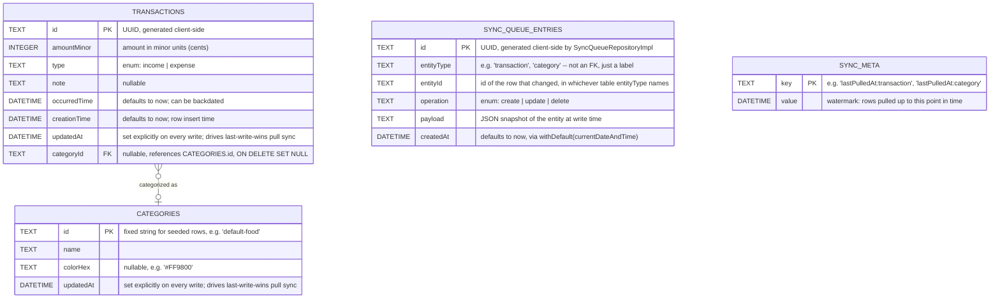

# Database schema

The local SQLite schema (via Drift) and the Supabase Postgres schema it syncs
with. Extracted from the README to keep that file short for a first-time
visitor. For *why* the columns look like this (client-generated UUIDs, integer
minor units, `ON DELETE SET NULL`), see
[`technical-decisions.md`](technical-decisions.md).

## Local schema (Drift / SQLite)



`SyncQueueEntries` deliberately has **no foreign key** to `Transactions` or
`Categories` — `entityType`/`entityId` are a soft reference by design, since
the whole point of the outbox is to keep a durable, replay-safe record of a
write that must survive the original row being deleted before the queue is
ever drained (see [the sync docs](sync-queue.md#the-outbox-every-write-enqueues)).

Current `schemaVersion`: **6**.

## Backend schema (Supabase)

The Postgres side that sync pushes to and pulls from is versioned in
[`supabase/migrations/`](../supabase/migrations/), applied with the
[Supabase CLI](https://supabase.com/docs/guides/local-development). It
mirrors the local tables above with a few differences:

| | Local (Drift/SQLite) | Remote (Postgres) |
|---|---|---|
| ids | `TEXT` | `uuid` (a non-UUID id fails the push, which is why the default categories use real UUIDs) |
| timestamps | whole seconds | `timestamptz` |
| owner | none (one user per device) | `user_id uuid` → `auth.users`, `ON DELETE CASCADE`, stamped at push time |
| access | n/a | Row Level Security on both tables, one `FOR ALL` policy each: `auth.uid() = user_id` |
| extra rules | — | `categories` is `UNIQUE (user_id, name)`; `transactions.type` is `CHECK (income, expense)` |

### The migrations

- **`..._baseline_remote_schema.sql`** is the schema as it already existed
  on the live project (created by hand in the dashboard during Weeks 5–6),
  reconstructed from `information_schema` / `pg_policies` / `pg_indexes`
  rather than dumped (`supabase db dump` needs Docker). It is idempotent, and
  was registered on the live project with `supabase migration repair
  --status applied` instead of being pushed. `updated_at` has no trigger, by
  design: the client sets it so last-write-wins compares when an edit
  happened, not when it reached the server.
- **`..._add_pull_query_indexes.sql`** adds `(user_id, updated_at)` indexes
  to match the pull query (`user_id = … and updated_at > … order by
  updated_at`), and is the first migration actually pushed.
- **`..._push_if_newer_functions.sql`** adds `push_category` and
  `push_transaction`: an insert-or-update that runs only when the stored
  `updated_at` is not newer than the pushed one (`security invoker`, so RLS
  still applies; `user_id` comes from `auth.uid()`; execute is granted to
  `authenticated` only). The client calls them with `rpc` instead of
  `upsert`, so last-write-wins also holds on push. Deploy this migration
  before an app build that calls the functions.

### Changing the backend

```bash
supabase migration new <name>     # write the SQL
supabase db push --dry-run
supabase db push
```

No local Docker replay is set up, so check a change by re-running the schema
queries against the project. Without a global install, prefix commands with
`npx supabase@latest`. `supabase login` and `supabase link --project-ref
<ref>` are per-machine; the access token and database password are never
committed (`supabase/.temp` is ignored).

**Known edge case:** because of `UNIQUE (user_id, name)`, two devices that
each create a category with the same name under different ids make the
second push fail on the constraint, and that queue entry retries forever.

## Regenerating the Drift code

`*.g.dart` files are generated. Re-run the generator whenever a table
definition under `lib/features/transactions/data/models/`,
`lib/features/categories/data/models/`, or `lib/core/sync/data/models/`
changes:

```bash
dart run build_runner build --delete-conflicting-outputs
```
