# Reactive data flow

There is no "refresh" step anywhere in this app. A write lands in SQLite,
Drift's `.watch()` query notices the table changed, and the new list arrives
back at the screen on its own.

Extracted from the README to keep that file short for a first-time visitor.
See also [`architecture.md`](architecture.md) for the directory tree and
layering rules, and [`technical-decisions.md`](technical-decisions.md) for
the trade-offs behind specific choices.

**→ [Open the interactive architecture diagram](https://claude.ai/code/artifact/7ef70167-84d3-4ec5-b1da-6acea789d354)**
for a visual walkthrough of the cycle described below.

```mermaid
flowchart LR
    UI["UI (BlocBuilder)"] -- "add(AppLaunchEvent)" --> Bloc[TransactionsBloc]
    Bloc -- "getTransactionsUseCase()\n(once, held in _subscription)" --> UC[GetTransactionsUseCase]
    UC --> Repo["TransactionsRepository\n(impl)"]
    Repo -- "select(transactions).watch()" --> DS[TransactionsDataSource]
    DS -- "SQL" --> DB[(SQLite via drift)]
    DB -- "table changed → re-run query" --> DS
    DS -- "Drift row" --> Repo
    Repo -- "TransactionEntity stream" --> UC
    UC -- "stream tick" --> Bloc
    Bloc -- "add(_TransactionsUpdated)\n→ emit(Loaded(data))" --> UI

    Sheet["AddTransactionSheet"] -- "add(AddTransactionEvent /\nDeleteTransactionEvent)" --> Bloc
    Bloc -- "addTransactionUseCase / deleteTransactionUseCase" --> Repo
    Bloc -. "emit(TransactionsError)\non failure only" .-> Sheet

    CatUI["CategoryTotalsCard\n(BlocBuilder)"] -- "subscribes once,\nin constructor" --> CatCubit[CategoryTotalsCubit]
    CatCubit --> CatUC[WatchCategoryTotalsUsecase]
    CatUC --> CatRepo["CategoryRepository\n(impl)"]
    CatRepo -- "leftOuterJoin + groupBy,\nwhere type == expense" --> DS
    DS -- "CategoryTotalRow list" --> CatRepo
    CatRepo -- "CategoryTotalEntity stream" --> CatUC
    CatUC -- "stream tick" --> CatCubit
    CatCubit -- "emit(totals)\ndirectly, no bridging event" --> CatUI
```

Each piece's job:

- **`TransactionsDataSource.allTransactions`** is a `Stream<List<Transaction>>`
  built from `select(transactions).watch()` — not a one-shot `Future`. Drift
  re-runs the query and re-emits automatically whenever a row in the
  `transactions` table changes.
- **`TransactionsRepositoryImpl.getAllTransactions()`** maps each Drift
  `Transaction` row to a `TransactionEntity` and passes the stream straight
  through — no `async`, no `Result<T>`. Writes (`addTransaction` /
  `deleteTransaction`) stay plain `Future<Result<T>>` and never return the
  updated list; the stream re-emitting is what updates the UI, not the
  write's return value.
- **`GetTransactionsUseCase` / `AddTransactionUseCase` / `DeleteTransactionUseCase`
  / `WatchBalanceUseCase`** are thin, single-method (`call(...)`) wrappers
  around one repository call each. `TransactionsBloc`/`BalanceCubit` depend
  only on these — never on `TransactionsRepository` directly — so the bloc
  layer never sees a Drift type.
- **`TransactionsBloc`** subscribes to `getTransactionsUseCase()` exactly
  once, in `_onLaunch` (guarded against double-subscribing), and stores the
  `StreamSubscription` in `_subscription`. Every tick is bridged through a
  private `_TransactionsUpdated` event (a Bloc handler can't `emit()` from
  inside a raw stream callback), which emits `Loaded(data)`.
  `AddTransactionEvent`/`DeleteTransactionEvent` handlers call the
  corresponding use case and **emit nothing on success** — the already-live
  subscription picks up the change on its own. They only emit
  `TransactionsError` if the write itself fails.
- **`_subscription.cancel()` in `close()`** is the one step with no automatic
  safety net (highlighted in the diagram). Skipping it leaks the Drift query
  listener past the Bloc's lifetime — since `TransactionsBloc` is a
  `getIt.registerFactory` instance created fresh per screen, forgetting this
  leaves one more orphaned subscription running after every navigation.
- **`AddTransactionSheet`** dispatches `AddTransactionEvent` and disables its
  submit button locally (`_isSubmitting`) while waiting — not via a Bloc
  `Loading` state, since none exists on the write path. A `BlocListener`
  (guarded by `listenWhen: (_, __) => _isSubmitting`) pops the sheet on the
  next `Loaded` and shows an inline error on `TransactionsError`, so failures
  surface before the sheet is dismissed instead of as a disconnected
  snackbar afterward.
- **`CategoryTotalsCubit`** follows the same aggregate-stream shape as
  `BalanceCubit`, not `TransactionsBloc`: it subscribes to
  `WatchCategoryTotalsUsecase()` once in its constructor and calls `emit`
  directly from the stream listener. A `Cubit` can do this safely — only a
  `Bloc` needs the private-event bridging trick `TransactionsBloc` uses,
  because a `Bloc`'s `emit` is only valid inside an event handler, while a
  `Cubit` has no such restriction.

## Swipe-to-delete + Undo

Deleting is optimistic on the UI side but not on the database side:

1. Swiping a row adds its id to a local `_pendingDeleteIds` set and hides it
   immediately — this keeps the rendered list in sync with what `Dismissible`
   already removed from the widget tree, avoiding a
   "dismissed Dismissible still in tree" crash.
2. A snackbar appears with an animated 5-second countdown bar and an **Undo**
   action.
3. If **Undo** is tapped, the id is removed from the pending set and the row
   reappears — no bloc event is ever dispatched, so nothing is deleted.
4. If the countdown finishes untouched, `DeleteTransactionEvent` fires and
   the row is permanently removed from the database; the live subscription
   reflects the deletion automatically.

## Observability

`main()` installs a custom `BlocObserver`
([`lib/core/app_bloc_observer.dart`](../lib/core/app_bloc_observer.dart)) via
`Bloc.observer = AppBlocObserver()` before `runApp`. It logs, through the
[`logger`](https://pub.dev/packages/logger) package:

- **`onEvent`** — every dispatched event (`AppLaunchEvent`,
  `AddTransactionEvent`, the internal `_TransactionsUpdated`, ...)
- **`onChange`** — every state transition (`TransactionsInitial` → `Loaded`,
  → `TransactionsError`, ...)
- **`onError`** — anything thrown inside a Bloc handler that wasn't already
  caught

This gives a full console trace of the reactive cycle above — useful for
seeing exactly when a stream tick reaches the Bloc versus when a write
handler runs.
