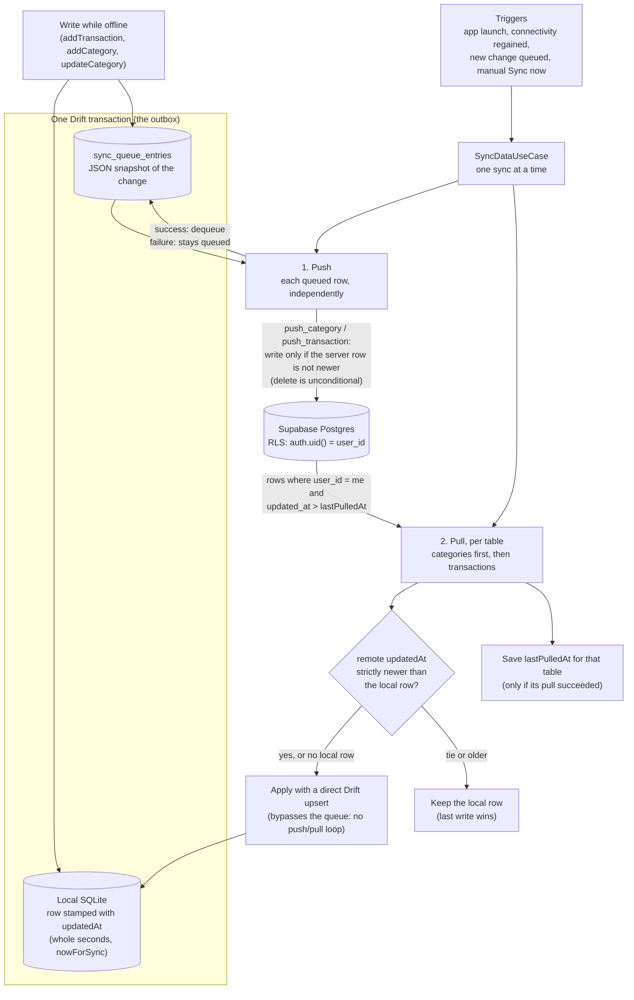
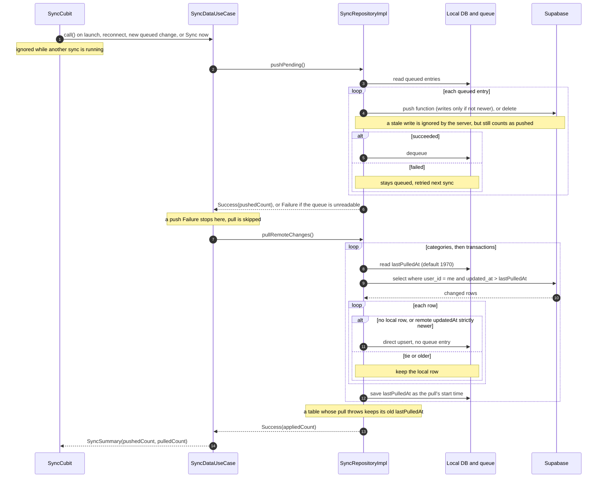

# Sync: the offline outbox, push, and pull

How local writes are recorded, why every write is queued unconditionally, how
queued writes reach Supabase, and how changes made on another device come
back down. The canonical sync reference — extracted from the README to keep
that file short for a first-time visitor.

- [The outbox: every write enqueues](#the-outbox-every-write-enqueues)
- [The decision: always enqueue (Option A)](#the-decision-always-enqueue-option-a)
- [Sync flow, end to end](#sync-flow-end-to-end)
- [Push sync to Supabase](#push-sync-to-supabase)
- [Pull sync (downloading changes from other devices)](#pull-sync-downloading-changes-from-other-devices)
- [Known gaps](#known-gaps)

Full decision log with interview-prep framing:
[`week5-decisions-and-interview-prep.md`](week5-decisions-and-interview-prep.md).

## The outbox: every write enqueues

Every write to `Transactions` or `Categories` also writes a row to
`SyncQueueEntries` — the local durable record of "this needs to reach the
server eventually." This is a **transactional outbox**: the pattern of
writing a business-data change and an "outbox" event in one atomic
transaction, so a separate process can drain the outbox and publish those
events (here, to Supabase) without ever risking the data change and the
sync record disagreeing about what happened.

```
user adds / edits / deletes a transaction or category
        │
        ▼
TransactionsRepositoryImpl / CategoryRepositoryImpl
        │
        ▼  dataSource.transaction(() async {  ← single Drift transaction
        │     1. write the row to the local DB
        │     2. syncQueueRepository.enqueue(...)   ← ALWAYS, online or offline
        │     3. if enqueue returned Failure -> throw  ← forces rollback of (1)
        │  })
        ▼
sync_queue_entries table   (one row per mutation)
        │
        ├─▶ watchPendingCount() → PendingSyncCubit → pending-changes badge
        │
        ▼
SyncRepositoryImpl.pushPending()  → Supabase, then dequeue on success
```

Relevant code:

- `lib/core/sync/domain/repositories/sync_queue_repository.dart` — the contract
- `lib/core/sync/data/repos/sync_queue_repository_impl.dart` — `enqueue`, `watchPendingCount`
- `lib/core/sync/data/models/sync_queue_entries.dart` — the Drift table
- `lib/core/sync/data/repos/sync_repository_impl.dart` — `pushPending`, `pullRemoteChanges`
- `lib/core/sync/domain/usecases/sync_data_usecase.dart` — push-then-pull sequencing
- `lib/features/transactions/data/repos/transactions_repository_impl.dart` — `addTransaction` / `deleteTransaction`
- `lib/features/categories/data/repos/category_repository_impl.dart` — `addCategory` / `updateCategory` / `deleteCategory`

### How the write side works

- **Every write always enqueues, online or offline.** There is exactly one
  code path for every write: local DB write, then enqueue — never a
  connectivity check that branches into "write directly to the server" vs.
  "queue it." Only the sync process ever talks to Supabase; from the
  repository's point of view, being online changes nothing about how a write
  happens, only how soon the drain runs.
- **The data write and the enqueue are wrapped in one Drift `transaction()`.**
  `TransactionsRepositoryImpl.addTransaction`/`deleteTransaction` and
  `CategoryRepositoryImpl.addCategory`/`updateCategory`/`deleteCategory` each
  open `dataSource.transaction(() async { ... })`, perform the actual
  insert/update/delete, then call `syncQueueRepository.enqueue(...)` before
  the block closes. If either half fails, Drift rolls back both — there is
  no window where a transaction/category row exists with no matching queue
  entry (which would mean it silently never syncs), and no window where a
  queue entry exists for a write that never actually committed (a "phantom"
  sync). Because `enqueue()` returns a `Result<int>` rather than throwing,
  and Drift's `transaction()` only rolls back on a *thrown* exception, a
  returned `Failure` from `enqueue` is deliberately re-thrown inside the
  transaction block and re-caught just outside it, converting it back to
  `Result` for the caller — see the comment at the throw site in
  `transactions_repository_impl.dart` for why.
- **`payload` is a full snapshot, captured at write time — not a pointer to
  re-fetch later.** `SyncQueueEntries.payload` holds a JSON-encoded copy of
  the entity's data (id, amount, type, note, category, etc. for a
  transaction) at the moment of the write, not just the row's id. The
  alternative — storing only `entityId` and having the drain process re-read
  the current row from local storage — was rejected because this app is
  offline-first by design: a write can sit unsynced for an unbounded time,
  and if the underlying row gets deleted locally before the drain ever runs,
  a pointer-based design would have nothing left to re-fetch and would
  silently lose that `create`/`update` event. A snapshot is self-sufficient —
  the queue row alone has everything needed to replay the write, independent
  of whatever local storage looks like by the time it's drained.
- **`SyncQueueRepository` is the only place that knows how to build a queue
  row.** Callers (`TransactionsRepositoryImpl`, `CategoryRepositoryImpl`)
  pass plain values — `entityType`, `entityId`, `operation`, `payload` —
  never a `SyncQueueEntriesCompanion`. `id` (a generated UUID) and
  `createdAt` (a Drift-side default, `withDefault(currentDateAndTime)`, the
  same pattern `Transactions.occurredTime` uses) are owned entirely by
  `SyncQueueRepositoryImpl`, so a third repository added later needs zero
  knowledge of the queue table's schema to participate — just the same
  four-value `enqueue(...)` call every existing writer already makes.
- **Presence in the queue *is* the pending state.** There is no
  `synced`/status column, by deliberate design (see
  [Push sync](#push-sync-to-supabase)).
  `SyncQueueRepository.watchPendingCount()` (backed by a `COUNT(*)` over the
  table) is therefore "rows not yet dequeued," not "rows that failed" — a row
  leaves the count only once its push actually succeeds.

## The decision: always enqueue (Option A)

Every mutating repository method enqueues a sync-queue row for the change **in
the same transaction as the local write**, regardless of the current
`NetworkStatus`. The row is the durable record of "the server does not know
about this change yet."

The rejected alternative (Option B) was: enqueue only when the device is
offline at write time, and write straight through when online.

### Why Option A

| Reason | Detail |
| --- | --- |
| Connectivity is not reachability | `connectivity_plus` reports whether a network *interface* is up (wifi / cellular), not whether the server is actually reachable. "Online" can still mean captive portal, DNS failure, server down, VPN split-brain. Gating enqueue on `NetworkStatus.online` would silently drop changes that only *looked* online. |
| No lost writes | A change made while genuinely online still is not on the server until a sync process pushes it and the server acknowledges. Until then it must live in the queue like any offline change. |
| One invariant to reason about | "Every local mutation has a queue row until a drain process removes it." Option B splits this into two cases and creates a reconciliation problem when connectivity flaps *during* a write. |
| Atomicity is already handled | The write and the enqueue share one `dataSource.transaction()`. Drift only rolls back on a thrown exception, so `enqueue` returning `Failure` is re-thrown inside the transaction and then converted back to a `Result` for the caller. Either both the row and its queue entry land, or neither does. |
| `enqueue` failure is a DB failure, not a network failure | `enqueue` does a local insert. It cannot fail because the network is down — only because the database itself is broken, in which case failing the whole write is correct. |

### Consequence: keep it

Do not "optimize" this by skipping the enqueue when online. If you are adding a
new mutating repository method, it must enqueue inside the same transaction and
re-throw on `Failure`, exactly like the existing five methods.

## Sync flow, end to end

How a change made offline reaches the server and how a change made
elsewhere reaches this device. The overview first, then one sync in order.





Reading it:

- **The outbox is atomic.** The local row and its queue entry commit in one
  Drift transaction, so a change is never saved without being queued.
- **Push first, then pull, every sync**, even when nothing was queued: pull
  is the only way this device learns about changes made elsewhere.
- **Pull writes bypass the queue.** Re-enqueueing a pulled row would push it
  back, change its `updated_at`, and be pulled again forever.
- **Last-write-wins holds on both halves.** The pull applies a remote row
  only if it is strictly newer. The push calls a Postgres function that
  writes only if the server row is not newer, so a stale queued edit cannot
  overwrite a newer edit from another device. The server ignores the stale
  write, the entry still counts as pushed and is dequeued, and the pull right
  after brings the newer row down (see
  [Push respects last-write-wins](#pull-sync-downloading-changes-from-other-devices)).
  Remote deletes are not propagated.

## Push sync to Supabase

The drain side of the outbox: `SyncRepositoryImpl.pushPending()` reads
every queued row, pushes each one to Supabase independently, and dequeues
it on success. `SyncCubit` decides *when* this runs; `SyncNowButton`/
`SyncSheet` let the user run it *on demand* too.

- **Auth is anonymous for now.** `main()` calls `signInAnonymously()` before
  `runApp` so `auth.uid()` is always non-null, which is what Supabase's Row
  Level Security policies actually check. Trade-off, accepted deliberately:
  each fresh install mints a brand-new `auth.uid()`, so there is no durable
  identity across reinstalls/devices yet — real email/password auth is
  future work.
- **Per-row failures don't block the rest of the queue.** `pushPending()`
  loops with a `try`/`catch` around each entry: a row that fails to push
  (network, RLS, a bad id) is logged and left queued for the next attempt;
  the loop continues to the next row rather than aborting the whole pass.
  This is safe specifically because `pushEntry`'s Supabase calls are
  idempotent — the `push_category` / `push_transaction` functions for
  create/update (an insert-or-update that a retry repeats harmlessly, since
  an equal `updated_at` is accepted), and `.delete().eq('id', ...)` for
  delete, which is already a no-op success (not an error) when the row is
  already gone.
- **No `status`/retry-count/error column, by choice.** A row's mere
  presence in `SyncQueueEntries` *is* "not yet confirmed on the server" —
  adding bookkeeping columns for retry counts or backoff was rejected as
  solving a problem this app doesn't have yet at solo-user scale. The one
  concession is per-row error *logging* (not persisted state) so a
  persistently failing row is at least visible in the console instead of
  silently retried forever.
- **The local→remote field mapping lives at the push boundary, not in the
  domain model.** `SupabaseSyncDataSource.mapForSupabase()` renames
  camelCase to snake_case (`amountMinor` → `amount_minor`, etc.) and stamps
  `user_id` immediately before the network call — the local Drift models
  and the queued payload never learn that Supabase, or its column-naming
  convention, exists. This also means a queued row written before an app
  update still pushes correctly after the update changes the mapping,
  since the mapping is applied at push time, not at enqueue time.
- **`SyncCubit` auto-triggers a push on two signals:** connectivity
  regaining `online`, and the pending count *increasing* while already
  online (covers "add a transaction while connected," which doesn't change
  `NetworkStatus` and so wouldn't otherwise be noticed). A count
  *decreasing* never re-triggers a push — that's a push having just
  succeeded, not a new change arriving.
- **`SyncCubit` exposes its outcome as state** (`SyncIdle` /
  `SyncInProgress` / `SyncCompleted` / `SyncFailure`), each carrying an
  `isManual` flag distinguishing a user-triggered `syncNow()` call from an
  auto-trigger. This is what lets the UI show a spinner and a result
  snackbar only for a push the user actually asked for — the silent
  auto-trigger stays silent. An in-flight guard (`if (state is
  SyncInProgress) return;`) stops a manual tap from stacking a second push
  on top of one already running.
- **`SyncCompleted.allFailed` is inferred, not observed.**
  `pushPending()` returns only a count of rows that fully succeeded — if
  every row in the queue fails, the return value is indistinguishable from
  "there was nothing to push." `SyncCubit` compares the pending count
  immediately before and after the push: non-empty before, zero pushed
  after, means everything failed. This is a deliberate, documented
  trade-off — an error *message* still isn't available in the UI, only the
  fact that nothing went through; upgrading `pushPending()`'s return type
  to a small success/failure-count summary is the known next step if that
  becomes a real pain point.
- **Default categories are a known, deferred gap.** The four seeded
  categories are inserted directly by Drift's `onCreate`, bypassing
  `CategoryRepositoryImpl.addCategory()` entirely — so they are never
  enqueued and never reach Supabase for any user. A guarded
  `enqueueDefaultCategories()` was built and then deliberately reverted: no
  correct one-shot guard existed without a persisted flag, and re-enqueuing
  on every launch would grow the queue unboundedly. Deferred until real
  (non-anonymous) auth exists, at which point a per-account seed becomes
  possible.
- **`pushEntry()`'s Supabase SDK calls aren't driven end-to-end in a test**
  (`SupabaseSyncDataSource.mapForSupabase()` is tested directly instead, in
  `sync/supabase_sync_data_source_test.dart`, together with `rpcCallFor()`,
  the pure function that picks the Postgres function and its arguments — see
  [testing.md](testing.md) — since mocktail can't reliably intercept the
  Supabase SDK's `.rpc()` / `.from(...)` awaitable chains).

## Pull sync (downloading changes from other devices)

The other half of two-way sync: `SyncRepositoryImpl.pullRemoteChanges()`
fetches rows changed remotely since each entity type's own watermark and
applies them locally. It runs right after every push, on the same triggers
(connectivity regained, a new local change queued, or manual "Sync now").

- **One use case runs the whole sync: `SyncDataUseCase`.** Push and pull
  used to be two use cases that `SyncCubit` called one after the other and
  unwrapped itself. They are now sequenced in the domain layer
  (`lib/core/sync/domain/usecases/sync_data_usecase.dart`): it runs
  `PushPendingChangesUseCase`, and returns a `Failure` straight away if the
  queue can't be read (pull is skipped), then runs
  `PullRemoteChangesUseCase` and returns a `SyncSummary` (`pushedCount`,
  `pulledCount`). Pull runs even when nothing was pushed, because it is the
  only way this device learns about changes made elsewhere.
  `SyncCubit` now only decides *when* to sync and turns the `Result` into
  `SyncState`; `allFailed` stays in the cubit because it needs the pending
  count from before the sync, which is cubit state, not domain.
- **A `lastPulledAt` watermark per entity type**, not one shared value.
  `SyncMeta` (a small key-value Drift table, keys like
  `lastPulledAt:transaction`) tracks each table's own progress, mirroring
  how push already treats each queue row's success/failure independently
  (see above) — one table's pull failing doesn't block or roll back the
  other's watermark.
- **Categories are pulled before transactions.** `transactions.category_id`
  is a foreign key to `categories`, and SQLite enforces it. Pulling
  transactions first made a fresh device reject any transaction whose
  category hadn't been pulled yet, skipping that table's pull until the
  next sync. A regression test (`test/sync/sync_repository_pull_test.dart`)
  covers it against a real in-memory database.
- **The watermark is captured before querying, not after applying.** A
  row that changes remotely while a pull is in flight is simply picked up
  again on the next pull instead of being missed — the alternative
  (stamping the watermark at completion) can silently skip a row that
  changed in that window.
- **Last-write-wins, compared on `updated_at`.** Every write path now
  stamps `updatedAt`/`updated_at` explicitly (client-side, in Dart —
  matching the `occurredTime`/`creationTime` convention, not a
  Postgres trigger, since the client is the one that knows *when the edit
  actually happened*, not just when it happened to reach the server).
  Applying a pulled row compares its `updated_at` against the local row's
  `updatedAt`: the incoming row only overwrites when it's strictly newer;
  a tie or an older incoming row leaves the local copy untouched.
- **`updatedAt` is stamped at whole-second precision.** Drift stores
  `DateTime` as whole seconds, so a local row written with `DateTime.now()`
  silently loses its milliseconds while the sync payload built from the same
  value keeps them. Supabase then held a slightly newer `updated_at` than the
  device's own row, and the next pull treated the device's own push as a
  remote change (visible as "1 pushed, 1 applied"). All three write paths
  (`addTransaction`, `addCategory`, `updateCategory`) now take their
  timestamp from `nowForSync()` (`lib/core/timestamps.dart`), which truncates
  to the second before both the local write and the payload are built, so
  the two always match. Trade-off: last-write-wins resolves at one-second
  granularity, so two edits in the same second tie, and a tie keeps the
  local copy.
- **Existing rows, migrated from schema v4/v5, default to "now," not to
  `occurredTime`.** Backfilling `updatedAt` from a domain field like
  `occurredTime` would falsely mark old, unrelated rows as "just edited,"
  making them incorrectly win future last-write-wins comparisons against
  genuinely newer data from other devices.
- **How a conflict is proven, and what that does not cover.** Edit a
  category on this device while offline (it is queued) and edit the same
  row on another device: `test/sync/pull_conflict_test.dart` shows the pull
  keeps whichever edit has the later `updated_at` in the local database, a
  tie keeps the local copy, and the pending local edit stays queued
  either way. A whole-sync test (real push then pull against a fake server
  that follows the push functions' rule) shows a stale queued edit no longer
  overwrites a newer remote edit, and both sides end on the later one. The
  scenario uses categories because transactions cannot be edited in the app
  yet (only added or deleted), so transaction last-write-wins is covered at
  the pull level only.
- **Push respects last-write-wins.** `pushEntry` used to do an
  unconditional `.upsert()`, and a sync pushes before it pulls, so a stale
  queued edit could overwrite a *newer* remote edit on the server before the
  pull ever saw it. It now calls a Postgres function per table
  (`push_category`, `push_transaction`) that inserts or updates only when
  the stored `updated_at` is not newer than the pushed one. A rejected stale
  write is a silent no-op, so the entry is still dequeued and the pull that
  follows applies the newer row locally; both sides converge on the later
  edit. `<=` is deliberate: a retried push of the same edit has an equal
  `updated_at` and must still succeed. The rule lives in SQL, so it is
  proven in the Supabase SQL editor (new row inserted, older ignored, newer
  and equal applied) and, for the client flow, by a whole-sync test in
  `pull_conflict_test.dart` against a fake server that follows the same
  rule. Limits: same-second edits tie and the later push wins; deletes are
  still unconditional; and an installed app version from before this change
  still upserts directly, so it keeps the old behavior until updated.

## Known gaps

1. **Remote deletes are not propagated.** `pushEntry`'s delete branch is a
   hard `.delete()` with no tombstone left behind, so a pull's
   `select ... where updated_at > :since` has nothing to find for a row that
   was deleted elsewhere — a delete made on one device does not yet remove
   that row on another. Fixing this needs a soft-delete (`deleted_at`) column
   on both tables plus a read-path filter everywhere.
2. **No coalescing.** Editing the same entity five times writes five queue
   rows. Compaction (last-write-wins per entity, or a proper op-log) is
   future work.
3. **No retry limit or backoff.** A row that fails forever is retried on
   every sync; only the console log makes it visible.
4. **Anonymous auth only.** No durable identity across reinstalls, which is
   also why the default seeded categories never sync (see
   [Push sync](#push-sync-to-supabase)).
5. **One-second conflict granularity.** Two edits in the same second tie, and
   a tie keeps the local copy.
6. **`UNIQUE (user_id, name)` on categories** means two devices that each
   create a category with the same name under different ids make the second
   push fail on the constraint, and that queue entry retries forever. See
   [database.md](database.md#backend-schema-supabase).
